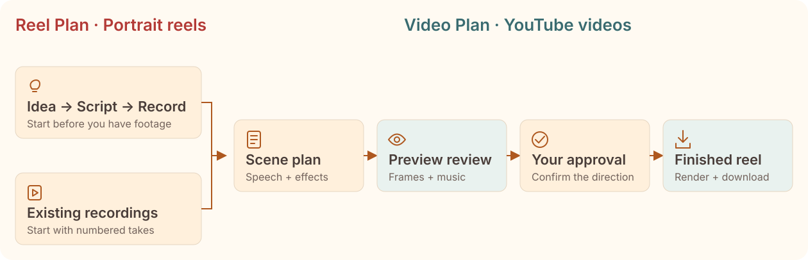
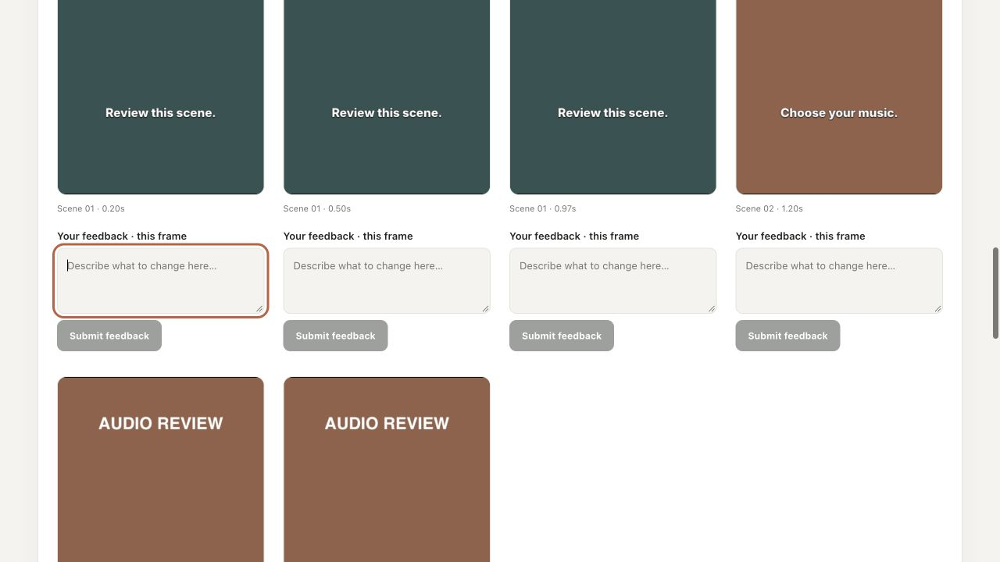
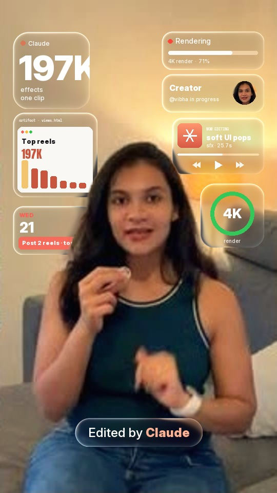

<div align="center">

<h1></h1>

**Create → Review → Finish**  
Make reels locally with your coding agent.

[🚀 Get started](#start-with-your-ai-assistant) · [⌨️ Commands](#commands) · [💻 System requirements](#system-requirements) · <a href="https://www.youtube.com/@techno_ravan"> Techno Ravan on YouTube</a>

Built by **[Nayan Vekariya (Techno Ravan)](#about-the-creator)**

</div>

## Start with your AI assistant

Paste this into a coding assistant with access to your computer’s files and terminal, such as Codex or Gemini CLI.

```text
Install Ravan Reel Studio from https://github.com/Nayan014/ravan-reel-studio and open the demo dashboard on my computer.
```

On the first launch, the studio downloads its tools and opens the bundled demo in your browser. Press **Play** to watch the six-second reel. If you already have a local checkout, run `npm start` from the project folder.

## How the studio works

Start with an idea or bring recordings. Choose Reel Plan for a portrait reel or Video Plan for YouTube. Each starts from an idea, existing footage or a saved project, then guides you through planning, review and export.

<picture>
  <source media="(max-width: 640px)" srcset="docs/images/workflow-mobile-ivory-planning.svg">
  
</picture>

## Create your first reel or YouTube video

1. **Start the studio.** Paste the installation prompt above into your coding agent. The demo dashboard opens when setup finishes.
2. **Bring your recordings.** Save numbered clips in `inputs/my-first-reel/`. Send `/wf-reel-plan` for a reel or `/wf-video-plan` for YouTube. Choose **I have footage** and enter that folder name.
3. **Review the direction.** Comment on the plan and approve it to see actual preview frames. Give feedback on any frame and choose music. Your agent revises the scenes you flag.
4. **Finish your reel.** Approve the current frames and audio. The studio renders effects, captions and sound, then adds your export to the dashboard.

> **Starting with an idea?** Send `/wf-reel-plan` or `/wf-video-plan` and choose **I have an idea** or **Suggest ideas**. Approve the script, record your takes and provide their folder to continue in the same workflow. Choose **Resume a project** to pick up saved work.

Name the clips `1.mp4`, `2.mp4`, `3.mp4` and so on. If your assistant does not recognise slash commands, ask it to read `AGENTS.md` and use the corresponding skill.

Output follows the recordings up to **4K/60**: portrait 2160×3840 for reels or landscape 3840×2160 for YouTube, including fractional frame rates. When takes differ, you choose the output profile.

<details>
<summary><strong>See a frame review and three sample effects</strong></summary>



| Orbit | Spotlight | Glass widgets |
| :---: | :---: | :---: |
|  |  |  |

[Browse the illustrated effects guide](docs/Video_Effects_Visual_Guide.pdf)

</details>

## Use a video as a style reference

Drop a video whose editing style you like into `references/`, then run `/wf-reel-plan` or `/wf-video-plan`. Choose **I have footage** if your own recordings are ready. The agent will offer the reference filenames and a **No reference** option when it prepares the production plan.

```text
inputs/       Your recordings
references/   Videos whose editing style you want to draw from
outputs/      Your projects and finished exports
```

The agent samples the selected reference locally, records observed pacing, text, colours, framing and transitions, then uses those notes to propose treatments for your scenes. Saved analysis is reused across projects. The first interpretation uses your agent's normal image-reasoning credits; subsequent runs read the cached style notes. Reference videos and cached analysis stay ignored by Git.

Already have footage? The planning command skips idea and pre-recording script steps. Reference-inspired effects still appear in the production plan and actual-frame review. [Reference workflow details](docs/REFERENCE_STYLES.md)

## Commands

Send these shortcuts directly to your coding assistant.

| Command | Purpose |
| --- | --- |
| `/wf-reel-plan` | Create a portrait reel from an idea, recordings or a saved project |
| `/wf-video-plan` | Create a landscape YouTube video from an idea, footage or a saved project |
| `/wf-video` | Choose Vibha effects or Nafay graphics for a single video |
| `/wf-nafay` | Edit one landscape video with Nafay 3D’s motion-graphics styles |
| `/wf-gallery` | Browse the effect reference pictures |
| `/wf-effects` | Apply a named effect |
| `/wf-resume` | Resume a saved single-video edit |

<details>
<summary>Prefer the numbered workflow menu?</summary>

Send `/wf`, then reply with a menu number. For example, `/wf` followed by **5** opens Reel Plan. Reply **6** for YouTube Video Plan.

| Reply | Workflow |
| --- | --- |
| 1 | Single-video edit |
| 2 | Effect gallery |
| 3 | Named effect |
| 4 | Resume an edit |
| 5 | Reel Plan |
| 6 | YouTube Video Plan |

</details>

`/wf reel-plan`, `/wf video-plan`, `/video-edit` and `/effects` remain available. Command discovery varies by agent; reading the shared instructions is the portable fallback.

## Nafay 3D motion graphics

Choose **Nafay motion graphics** in `/wf-video`, or send `/wf-nafay` with your recording. The standalone editor offers seven styles, including Warm Canvas, Clean Tech, Chalk Talk and Data Story, with cut review, actual-frame feedback and source-quality landscape output.

[Explore all seven styles and the editing flow](docs/NAFAY_VIDEO_EDITOR.md) · [Nafay 3D](https://nafay3d.com/)

## System requirements

| Use | Processor guidance | RAM | Suggested free SSD space |
| --- | --- | ---: | ---: |
| Dashboard and reviewing files | Modern laptop supporting Node.js | 8 GB | Space for your media |
| Short 1080p reels | Apple Silicon or a modern multicore Intel/AMD CPU | 16 GB | 20 GB+ |
| 4K/60 reels | Apple Silicon Pro-class or a strong modern multicore CPU | 32 GB+ | 50 GB+ |

These figures are practical starting points. Allow the suggested free space in addition to your original footage. Long takes and complex effects need more time and memory. YouTube projects appear under Videos in the dashboard and are saved in `outputs/videos/`; reels use `outputs/reels/`.

Tested on macOS with an **Apple M4 Pro and 48 GB of memory**. Windows and Linux setup instructions are available, with end-to-end validation pending. Default speech recognition runs on the CPU. [Setup and troubleshooting](docs/SETUP.md) · [Upstream CPU documentation](https://github.com/SYSTRAN/faster-whisper#small-model-on-cpu)

Speech recognition, trimming and rendering run locally. Your coding assistant may use an external service and incur charges. Git ignores your recordings and generated exports.

> The planning, reference-style and standalone Nafay integrations are implemented. Workflow testing is pending.

## Guides and contributions

[Reel workflow](docs/COMBINED_REEL_WORKFLOW.md) · [Review controls](docs/WORKFLOW_REVIEW.md) · [Contributing](CONTRIBUTING.md)

## Credits and licence

| Contribution | Credit |
| --- | --- |
| Original effects engine and bundled effect catalogue | [Vibha Ramprakash — claude-video-effects](https://github.com/Vibha-Ramprakash/claude-video-effects) |
| Guided workflows, review integration and Ravan Reel Studio | Techno Ravan |
| Adapted dashboard and legacy Remotion kit | [Techno Reel by Nayan V.](https://github.com/Nayan014/techno-reel) |
| Seven motion-graphics styles and standalone AI Video Editor | [Nafay 3D](https://nafay3d.com/) · [YouTube](https://www.youtube.com/@nafay3d) |
| HTML finishing and Studio editor | [Hyperframes by HeyGen](https://github.com/heygen-com/hyperframes) |
| Music, sound effects, fonts and tracking models | Individual authors listed in [third-party notices](THIRD_PARTY_NOTICES.md) |

Original project contributions use the [MIT licence](LICENSE). Third-party code, media, fonts and models retain their own licences and notices. The project licence does not replace those terms. Upstream versions and local adaptations are recorded in [SOURCE.json](SOURCE.json).

## About the creator

<div align="center">

<a href="https://vekariya.ai.studio/"></a>

### Nayan Vekariya

**Techno Ravan**

I build Ravan Reel Studio and share tutorials on the Techno Ravan channel.<br>
Explore the project with me on YouTube, or connect through my website and socials.

<a href="https://www.youtube.com/@techno_ravan"></a>
<a href="https://www.linkedin.com/in/nayan-vekariya/"></a>
<a href="https://www.instagram.com/techno_ravan/"></a>
<a href="https://vekariya.ai.studio/"></a>

</div>
