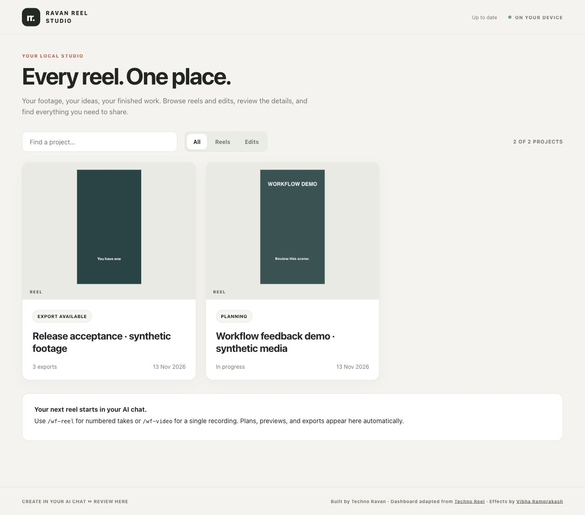

<div align="center">

# Ravan Reel Studio

**Create, review and finish reels locally with your coding agent.**

[🚀 Get started](#start-with-your-ai-assistant) · [⌨️ Commands](#commands) · [💻 Laptop guide](#can-my-laptop-run-it) · [▶️ Techno Ravan on YouTube](https://www.youtube.com/@techno_ravan)

</div>

Turn numbered takes into a captioned reel, or start with an idea and write the shooting plan first. Choose effects, leave feedback on individual frames and listen to music against your voice before you approve the render.

Built by **Nayan Vekariya (Techno Ravan)**, using [Vibha Ramprakash’s open-source video effects engine](https://github.com/Vibha-Ramprakash/claude-video-effects).



*The local library brings together your reels, covers, downloads and posting copy. The screenshot uses synthetic demonstration projects.*

## Start with your AI assistant

Paste this into a coding assistant with access to your computer’s files and terminal, such as Codex or Gemini CLI.

```text
Install Ravan Reel Studio from https://github.com/Nayan014/ravan-reel-studio and open the demo dashboard on my computer.
```

On the first launch, the studio downloads its tools and opens the bundled demo in your browser. Press **Play** to watch the six-second reel. If you already have a local checkout, run `npm start` from the project folder.

## Create your first reel

1. **Bring an idea or recordings.** For an idea, send `/wf-reel-plan` to draft the script and shooting plan. For existing recordings, put `1.mp4`, `2.mp4` and your other numbered takes in `inputs/my-first-reel/`, then send `/wf-reel`.
2. **Review the cut.** Read the transcribed speech alongside the scene plan. Pick from 51 effects and three bonus looks, then comment directly beneath any preview frame you want to change.
3. **Choose the sound and approve.** Audition the music with your voice. Once you approve the frames and audio, Vibha renders the effects and Hyperframes assembles the clips, captions, music and sound cues. The finished export appears in the dashboard.

The workflow matches recording quality up to portrait **4K/60**, including fractional frame rates. When takes differ, you choose the output profile.

<details>
<summary><strong>See a frame review and three sample effects</strong></summary>


| Orbit | Spotlight | Glass widgets |
| :---: | :---: | :---: |
|  |  |  |

[Browse the illustrated effects guide](docs/Video_Effects_Visual_Guide.pdf)

</details>

## Commands

Use a shortcut directly, or send `/wf` to open the numbered menu.

| Command | Purpose | Menu choice |
| --- | --- | --- |
| `/wf-video` | Guided edit of a single video | 1 |
| `/wf-reel-plan` | Develop and approve a script before recording | 6 |
| `/wf-reel` | Combine numbered recorded takes | 5 |
| `/wf-gallery` | Browse the effect reference pictures | 2 |
| `/wf-effects` | Apply a named effect | 3 |
| `/wf-resume` | Resume a saved single-video edit | 4 |

`/wf reel`, `/wf reel-plan`, `/video-edit` and `/effects` remain available. Command discovery varies by agent; reading the shared instructions is the portable fallback.

## Can my laptop run it?

| Use | Processor guidance | RAM | Suggested free SSD space |
| --- | --- | ---: | ---: |
| Dashboard and reviewing files | Modern laptop supporting Node.js | 8 GB | Space for your media |
| Short 1080p reels | Apple Silicon or a modern multicore Intel/AMD CPU | 16 GB | 20 GB+ |
| 4K/60 reels | Apple Silicon Pro-class or a strong modern multicore CPU | 32 GB+ | 50 GB+ |

These figures are practical starting points. Allow the suggested free space in addition to your original footage. Long takes and complex effects need more time and memory.

Tested on macOS with an **Apple M4 Pro and 48 GB of memory**. Windows and Linux setup instructions are available, with end-to-end validation pending. Default speech recognition runs on the CPU. [Setup and troubleshooting](docs/SETUP.md) · [Upstream CPU documentation](https://github.com/SYSTRAN/faster-whisper#small-model-on-cpu)

Speech recognition, trimming and rendering run locally. Your coding assistant may use an external service and incur charges. Git ignores your recordings and generated exports.

## About the creator

<a href="https://vekariya.ai.studio/"></a>

**Nayan Vekariya** builds Ravan Reel Studio and publishes tutorials as **Techno Ravan**. Follow the channel for tutorials or connect with Nayan through the links below.

[YouTube](https://www.youtube.com/@techno_ravan) · [Website](https://vekariya.ai.studio/) · [LinkedIn](https://www.linkedin.com/in/nayan-vekariya/) · [Instagram](https://www.instagram.com/techno_ravan/)

## Guides and contributions

[Reel workflow](docs/COMBINED_REEL_WORKFLOW.md) · [Review controls](docs/WORKFLOW_REVIEW.md) · [Contributing](CONTRIBUTING.md)

## Credits and licence

| Contribution | Credit |
| --- | --- |
| Original effects engine and bundled effect catalogue | [Vibha Ramprakash — claude-video-effects](https://github.com/Vibha-Ramprakash/claude-video-effects) |
| Guided workflows, review integration and Ravan Reel Studio | Techno Ravan |
| Adapted dashboard and legacy Remotion kit | [Techno Reel by Nayan V.](https://github.com/Nayan014/techno-reel) |
| HTML finishing and Studio editor | [Hyperframes by HeyGen](https://github.com/heygen-com/hyperframes) |
| Music, sound effects, fonts and tracking models | Individual authors listed in [third-party notices](THIRD_PARTY_NOTICES.md) |

Original project contributions use the [MIT licence](LICENSE). Third-party code, media, fonts and models retain their own licences and notices. The project licence does not replace those terms. Upstream versions and local adaptations are recorded in [SOURCE.json](SOURCE.json).
