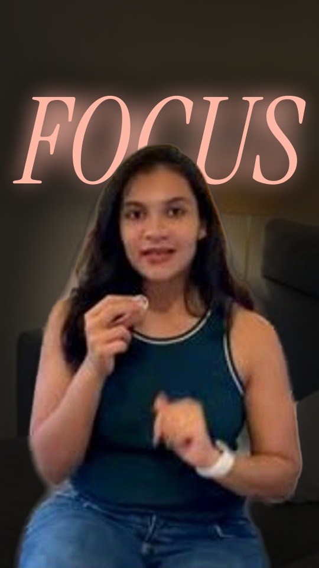

# Ravan Reel Studio

**Create, review and finish reels locally with your coding agent.**

Built by **Techno Ravan**, using **[Vibha Ramprakash’s open-source video effects engine](https://github.com/Vibha-Ramprakash/claude-video-effects)**. Vibha created the original effects engine; this project adds guided workflows, interactive review, a project dashboard and finishing integrations.

Turn a folder of recorded takes into a reel, or develop an idea into a script before recording. Review the script, comment on individual scenes and frames, choose music, then approve the finished direction before rendering.

## Start with your AI assistant

Open a coding assistant that can access files and run commands on your computer, such as Codex or Gemini CLI. Paste this message:

```text
Install Ravan Reel Studio from https://github.com/Nayan014/ravan-reel-studio and open the demo dashboard on my computer.
```

The first launch downloads the tools it needs and loads the bundled demo. Your computer may ask you to approve an installation. When the dashboard opens, press **Play** to watch the six-second demo.

If you already have the repository open in a terminal, run `npm start`. For manual installation or dashboard-only use, see the [setup guide](docs/SETUP.md).

## What you can do

- Apply **51 talking-head effects and 3 bonus looks** from the bundled catalogue.
- Plan short recording takes, transcribe speech locally and trim recordings.
- Review HTML plans and actual frames with feedback attached to the right revision.
- Finish new reels with **Vibha → Hyperframes**: effects, one spoken-caption layer, music and sound cues.
- Match source resolution and frame rate up to portrait **4K/60**, including fractional rates. Mixed sources require an explicit choice.
- Browse reels, covers, posting copy and downloads in a local dashboard.

Existing Remotion projects remain compatible. Creation and editing happen with your coding agent; the dashboard collects review feedback and does not run AI on its own.

## A look inside


*Actual dashboard with synthetic demonstration projects: colour-card footage, tones and a credited upstream example voice. No personal recordings are shown. The bundled six-second demo described below is installed by `npm start`; this screenshot also shows separate test projects.*

<details>
<summary>See feedback beneath actual preview frames</summary>


*This review example uses colour cards and tones. Its sample captions demonstrate the interface; they are not transcriptions of the tones.*

</details>

| Original effects: orbit | Original effects: spotlight | Original effects: glass widgets |
| --- | --- | --- |
|  |  |  |

*Bundled effect references, not effects applied to your footage. [Browse the illustrated guide](docs/Video_Effects_Visual_Guide.pdf).*

## Can my laptop run it?

These are **practical starting recommendations, not benchmarked minimum requirements**. A desktop with comparable specifications also works.

| Use | Processor guidance | RAM | Suggested free SSD space |
| --- | --- | ---: | ---: |
| Dashboard and reviewing files | Modern laptop supporting Node.js | 8 GB | Space for your media |
| Short 1080p reels | Apple Silicon or a modern multicore Intel/AMD CPU | 16 GB | 20 GB+ |
| 4K/60 reels | Apple Silicon Pro-class or a strong modern multicore CPU | 32 GB+ | 50 GB+ |

Rendering space is **additional to original recordings**. Copied sources, intermediate videos, actual-frame previews, model downloads and caches consume more disk space. Longer takes and complex effects increase memory use and render time; real-time rendering is not promised.

The reference machine is **Apple M4 Pro with 48 GB memory**. This is the tested configuration, not a requirement. macOS is validated; Windows and Linux have setup guidance but have not been validated end to end. The default transcription backend runs on CPU; a dedicated NVIDIA GPU is not required for that path. See the [upstream CPU implementation](https://github.com/SYSTRAN/faster-whisper#small-model-on-cpu) and [setup details](docs/SETUP.md).

## Create your first reel

### 1. Add your recordings

Create a folder such as:

```text
inputs/my-first-reel/
  1.mp4
  2.mp4
  3.mp4
```

Use unique numbered filenames. Keep your original recordings; the workflow imports copies. Videos and generated output are ignored by Git.

### 2. Start the reel workflow

Use an agent with local file and terminal access. Ask it to **read `AGENTS.md`**, then send:

```text
/wf-reel
```

Choose the recording folder, confirm the speech, choose treatments, review the plan and actual frames, and audition music. Full rendering waits for approval of the current frames and audio. If slash commands are unavailable, say **“Read AGENTS.md and use the wf-reel skill.”**

Starting without footage? Use **`/wf-reel-plan`** to choose an idea, review the script and shooting plan, then attach numbered recordings later.

Finished reels, previews and posting copy live in `outputs/reels/`. Single-video edits live in `outputs/edits/`. Feedback is processed by the active agent or collected when you resume. [Full reel workflow →](docs/COMBINED_REEL_WORKFLOW.md)

## Commands

Use a shortcut directly, or send `/wf` to open the numbered menu.

| Command | Purpose | Menu choice |
| --- | --- | --- |
| `/wf-video` | Guided edit of a single video | 1 |
| `/wf-reel-plan` | Develop and approve a script before recording | 6 |
| `/wf-reel` | Combine numbered recorded takes | 5 |
| `/wf-gallery` | Browse the effect reference pictures | 2 |
| `/wf-effects` | Apply a named effect | 3 |
| `/wf-resume` | Resume a saved single-video edit | 4 |

`/wf reel`, `/wf reel-plan`, `/video-edit` and `/effects` remain available. Command discovery varies by agent; reading the shared instructions is the portable fallback.

## Local processing, privacy and costs

Speech analysis, trimming and video rendering run locally in the default reel workflow. Your chosen coding agent may use an external AI service and may incur subscription or API costs. Idea research can use the internet. Do not assume media or chat attachments stay on your device merely because rendering is local.

The first run downloads packages, a browser if needed, and a speech model. Once cached, the default media-processing steps can run without a model API. Caches are reused for unchanged speech, clips and effects. No social account, voice-generation service or automatic publishing is required.

## Help and development

- **Empty library:** expected with dashboard-only setup. Run `npm start` for the bundled demo, or create a project with your agent.
- **Port busy:** set `DASHBOARD_PORT=4174` before `npm run dashboard`.
- **Missing speech dependency:** rerun `bash skills/effects/scripts/setup.sh --reel`.
- **Changed plan or frames:** generate a fresh review and approve that revision.
- **Slow rendering:** close heavy apps, keep takes short and use an SSD. Changing music reuses valid effect clips; changing output quality requires new video artifacts.

See [setup and troubleshooting](docs/SETUP.md), [review controls](docs/WORKFLOW_REVIEW.md), and [contributing and verification](CONTRIBUTING.md).

## Credits and licence

| Contribution | Credit |
| --- | --- |
| Original effects engine and bundled effect catalogue | [Vibha Ramprakash — claude-video-effects](https://github.com/Vibha-Ramprakash/claude-video-effects) |
| Guided workflows, review integration and Ravan Reel Studio | Techno Ravan |
| Adapted dashboard and legacy Remotion kit | [Techno Reel by Nayan V.](https://github.com/Nayan014/techno-reel) |
| HTML finishing and Studio editor | [Hyperframes by HeyGen](https://github.com/heygen-com/hyperframes) |
| Music, sound effects, fonts and tracking models | Individual authors listed in [third-party notices](THIRD_PARTY_NOTICES.md) |

Original project contributions use the [MIT licence](LICENSE). Third-party code, media, fonts and models retain their own licences and notices. The project licence does not replace those terms. Upstream versions and local adaptations are recorded in [SOURCE.json](SOURCE.json).
